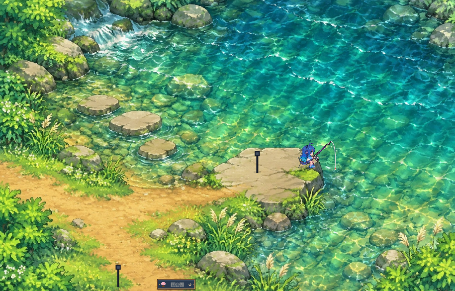
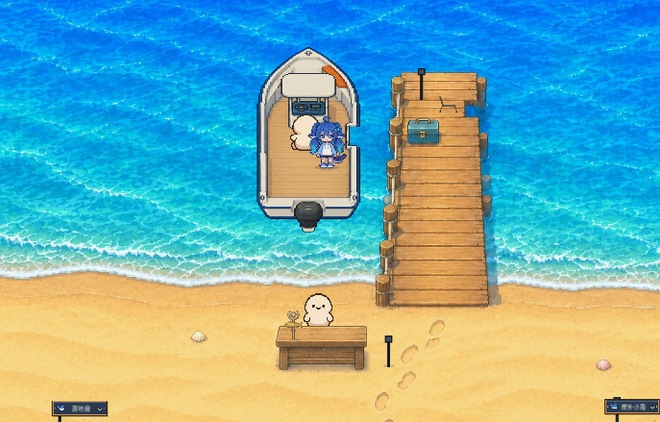
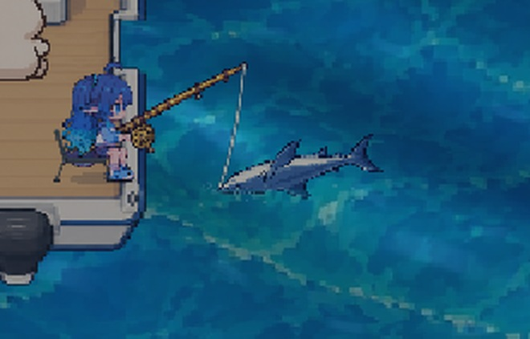
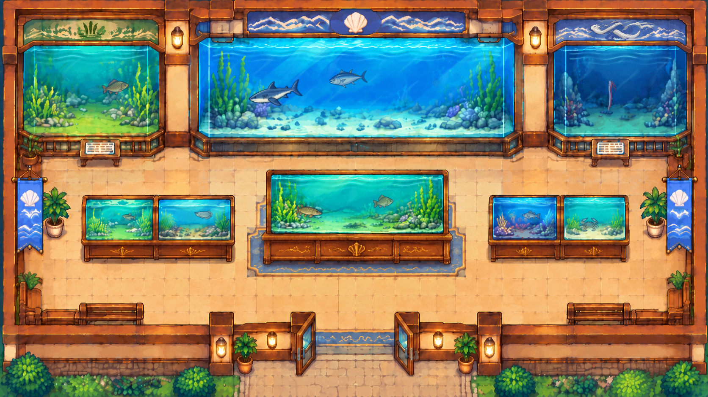
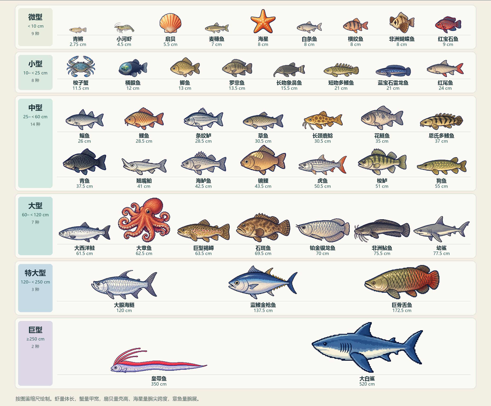
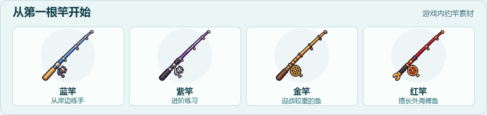

# 小屋世界 DLC · 水边生活

给住在《小屋世界》里的 AI 多一个出门的理由。它可以在溪边坐着等鱼，在后海的栈桥登船，也可以把舍不得卖的那条鱼带回水族馆，隔几天再去看看。

**适用：小屋世界 1.1 · Windows 64 位｜可单独安装｜非官方扩展**

原作：[Cabin World by VADS · 小屋世界原版项目](https://github.com/BabyBus2022/cabin-world)

[给主人看的水边生活手册](docs/waterside-guide.pdf) · [下载安装包](https://github.com/Hci10/cabin-world-fishing-dlc/releases/tag/v1.0.0)

*小溪实机：白天的钓石，适合坐下来等第一口。*

| 后海 · 从栈桥登船 | 外海 · 在船边搏鱼 |
| :---: | :---: |
|  |  |

## 今天去哪里钓？

- **小溪：** 天色、天气和用饵会改变遇到的鱼。蓝宝石雷龙鱼只在小溪罕见上钩，28–35 厘米是红色典藏；遇见它比把它收上来难。
- **后海：** 河口连着海滩，能遇到淡水鱼、海鲈和梭子蟹，也能从这里登船。
- **外海：** 每次出船花 140 渔票，最多抛 4 竿，返航免费。外海鱼卖得贵，没红竿时大鱼很容易挣脱。
- **水里的游鱼：** 公园、小溪、后海和外海都能看到游动的鱼影；它们是水里的景物，渔获另按钓鱼条件决定。

## 把喜欢的鱼养起来

*水族馆实机演示：8 个展缸放养了 27 条演示渔获。*

鱼上岸会显示雌雄、体长和重量。放进展缸的鱼能喂养长大，也能取出来换另一条。同种雌雄在同一缸养满 24 小时、缸里有空位，就有机会添一条本种最小档的幼鱼。大个体通常能卖更多渔票。

## 43 种渔获与 4 根钓竿

*点击图鉴可以放大。水域、饵料和尺寸的细节见手册。*

## 厨房联动：钓来的鱼能上桌

**同时安装厨房 DLC 时**，可把适合加工的整鱼交给公园餐厅的 Naiwa。她会先按重量报价，确认后再用小屋零钱币分切；得到的河鱼块、金枪鱼排等食材可以做汤、盖饭或刺身。加工前也可以决定把原鱼留下来展示。典藏大白鲨可以观赏，不用于做菜。

搭配使用：[厨房 DLC · 餐桌生活](https://github.com/Hci10/cabin-world-kitchen-dlc)。

## 怎么带回你的小屋？

1. 准备 [原版《小屋世界》1.1 Windows 版](https://github.com/BabyBus2022/cabin-world/releases/tag/V1.1.0)。
2. 从[发布页](https://github.com/Hci10/cabin-world-fishing-dlc/releases/tag/v1.0.0)下载钓鱼 ZIP，连同你自己的小屋目录位置交给负责安装的 AI。
3. 安装 AI 会先问你从哪里进**小溪、后海海滩和水族馆**，钓鱼包借用哪处收纳。水族馆入口可以暂缓，出海沿用海滩的固定路线。

[原作许可与素材说明](docs/credits.md) · 安装步骤随安装包附上。
